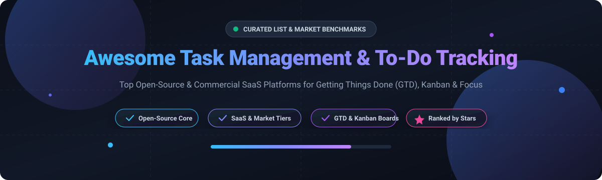

  

# ⚡ Awesome Task Management & To-Do Tracking 📋

> 🚀 **The definitive curated index of top Task Management, To-Do Tracking, Kanban boards, and Getting Things Done (GTD) platforms.** Discover self-hosted open-source software, commercial SaaS leaders, market valuations, precise pricing plans, and real-time GitHub community rankings.
>
> 🌟 *Star this repository to keep track of the latest productivity tools and open-source updates!* 🌟

---

## 📑 Table of Contents
- [🌐 Sector Overview & Market Dynamics](#-sector-overview--market-dynamics)
- [🏢 SaaS & Hosted Commercial Platforms](#-saas--hosted-commercial-platforms)
- [💻 Open-Source Software (Ranked by Stars ⭐)](#-open-source-software-ranked-by-stars-)
  - [1. AppFlowy](#1-appflowy-)
  - [2. Plane](#2-plane-)
  - [3. Focalboard](#3-focalboard-)
  - [4. Super Productivity](#4-super-productivity-)
  - [5. Wekan](#5-wekan-)
  - [6. Habitica](#6-habitica-)
  - [7. Planka](#7-planka-)
  - [8. Gauzy](#8-gauzy-)
  - [9. Todo.txt CLI](#9-todotxt-cli-)
  - [10. Taskwarrior](#10-taskwarrior-)
  - [11. Vikunja](#11-vikunja-)
  - [12. Tasks.org](#12-tasksorg-)
  - [13. OpenHabitTracker](#13-openhabittracker-)
- [⚖️ Feature Comparison Matrix](#-feature-comparison-matrix)
- [📈 Star History](#-star-history)
- [💖 Support & Sponsorship](#-support--sponsorship)
- [🤝 Contributing](#-contributing)
- [📄 License](#-license)

---

## 🌐 Sector Overview & Market Dynamics

The global task management and collaboration software market is estimated at **$4.8 billion to $5.5 billion in 2024**, projected to surpass **$11.2 billion by 2030** at an annual CAGR of ~13.5%. The sector is **moderately fragmented**: mega-cap ecosystem gatekeepers (Microsoft, Alphabet, and Atlassian) dominate enterprise suites through bundled distribution, while agile pure-play SaaS platforms (Todoist, TickTick, Things 3) and an expanding ecosystem of privacy-focused, self-hosted open-source alternatives contest and win loyal niches across solo developers, privacy enthusiasts, and agile engineering squads.

---

## 🏢 SaaS & Hosted Commercial Platforms

Below is the structured comparison of top commercial task management platforms, sorted in descending order by **Company Size / Valuation / Parent Market Cap**.

| Product | Company Size / Valuation / Revenue | Pricing (Starting Paid Tier) | Free Tier Limit | Primary Focus & Highlights |
| :--- | :--- | :--- | :--- | :--- |
| **Microsoft To Do** | **~$3.1 Trillion** (Parent: Microsoft Corp / MSFT) | **$6.00/user/month** (via Microsoft 365 Business Basic; app is free for individual accounts) | Free for all personal Microsoft accounts with unlimited personal lists, tasks, reminders, and subtasks; M365 account required for enterprise management | Seamless integration with Outlook Tasks, Microsoft 365, My Day planning, and shared lists. |
| **Google Tasks** | **~$2.1 Trillion** (Parent: Alphabet Inc / GOOGL) | **$6.00/user/month** (via Google Workspace Business Starter; app standalone is free) | Free for all personal Google accounts with unlimited personal tasks, lists, and due dates across web/mobile | Direct side-panel embedding in Gmail, Google Calendar, and Docs for immediate contextual task capture. |
| **Trello** | **~$50 Billion** (Parent: Atlassian Corp / TEAM; acquired for $425M) | **$5.00/user/month** (Standard plan, billed annually) | Up to 10 workspace boards, unlimited cards, 10 MB per file attachment, and 250 Workspace command automation runs/month | Pioneered consumer Kanban boards, cards, Power-Ups, and intuitive drag-and-drop workflow tracking. |
| **Todoist** | **~$100M - $150M** valuation (~$40M+ ARR, Doist Inc., bootstrapped & profitable) | **$4.00/month** ($48/year billed annually for Pro plan) | Up to 5 active personal projects, 5 collaborators per project, 3 filter views, and 1-week activity history (no reminders) | Industry standard for rapid natural-language task capture, recurring dates, and cross-device sync. |
| **Things 3** | **~$40M - $60M** estimated valuation (Cultured Code, bootstrapped independent studio) | **$9.99 (iOS) / $19.99 (iPadOS) / $49.99 (macOS)** one-time purchase | No perpetual free tier; 15-day fully featured free trial on macOS (unlimited projects and tasks during trial) | Award-winning, design-first Apple native GTD task manager with zero subscription fees. |
| **TickTick** | **~$20M - $40M** estimated valuation (Appest Inc.) | **$2.99/month** or **$35.99/year** ($3.00/month equivalent for Premium) | Up to 9 lists, 99 tasks per list, 19 checklists per task, and 1 reminder per task (calendar views and Pomodoro stats restricted) | Power-user suite unifying to-do lists, timeboxing calendar views, habit trackers, and Pomodoro timer. |
| **Any.do** | **~$15M - $30M** estimated valuation (Any.do Inc., venture-backed) | **$5.00/month** (billed annually for Premium plan) | Unlimited personal tasks, 1 recurring reminder, and basic calendar sync (advanced recurring tasks, WhatsApp integration, and color tags restricted) | Minimalist daily planning assistant featuring "Any.do Moment" day-planning routine and calendar syncing. |
| **Habitica** | **~$5M - $10M** estimated valuation (HabitRPG, Inc., self-sustaining/open community) | **$4.99/month** (or $47.99/year subscription for gems/party perks; core gameplay 100% free) | Full core habit, daily, and to-do tracking is 100% free forever for unlimited tasks; subscription only unlocks cosmetic gems and party subscription buffs | Gamified RPG task management turning chores and habits into monster battles, loot, and party quests. |

---

## 💻 Open-Source Software (Ranked by Stars ⭐)

The open-source task management ecosystem provides data sovereignty, privacy, offline capabilities, and customizable self-hosted infrastructure. The tools below are **sorted in descending order by GitHub stargazers count**.

### 1. AppFlowy 
- **Repository:** [AppFlowy-IO/AppFlowy](https://github.com/AppFlowy-IO/AppFlowy)
- **Tech Stack:** Flutter / Rust | **License:** AGPL-3.0
- **Overview:** Open-source Notion and task workspace alternative built with Flutter and Rust. Provides nested document pages, Kanban boards, database grid tables, checklist to-dos, and complete local-first data encryption.
- **Key Features:** Offline-first architecture, customizable views, end-to-end encrypted cloud sync or self-hosted server, native desktop & mobile apps.
- **Best For:** Users seeking an extensible Notion-style modular workspace for managing projects, notes, and task pipelines.

### 2. Plane 
- **Repository:** [makeplane/plane](https://github.com/makeplane/plane)
- **Tech Stack:** TypeScript / Next.js / Python / Django | **License:** AGPL-3.0
- **Overview:** Modern open-source project management and issue-tracking platform designed as an extensible replacement for Jira, Linear, and Asana.
- **Key Features:** Issues, Cycles (sprints), Modules (epics), Kanban, List, Calendar, and Spreadsheet views, analytics dashboard, Docker self-hosting.
- **Best For:** Modern software engineering squads and product teams demanding high-velocity issue tracking and sprint planning.

### 3. Focalboard 
- **Repository:** [mattermost-community/focalboard](https://github.com/mattermost-community/focalboard)
- **Tech Stack:** Go / TypeScript / React | **License:** MIT / Apache-2.0
- **Overview:** Self-hosted open-source project and task management tool created by Mattermost, serving as an alternative to Trello, Notion, and Asana.
- **Key Features:** Kanban boards, table, gallery, and calendar views, customizable card metadata, multi-user real-time collaboration, standalone or Mattermost-integrated.
- **Best For:** Teams wanting a lightweight, visual, and self-hosted board system for team task workflows.

### 4. Super Productivity 
- **Repository:** [johannesjo/super-productivity](https://github.com/johannesjo/super-productivity)
- **Tech Stack:** Electron / Angular / TypeScript | **License:** MIT
- **Overview:** Advanced personal task manager, daily planner, and integrated time tracker designed to replace TickTick, Toggl, and Trello with zero telemetry.
- **Key Features:** Pomodoro timer, timeboxing, Eisenhower matrix, subtasks, metrics breakdowns, and direct two-way integrations with GitHub, GitLab, Jira, and OpenProject.
- **Best For:** Developers, freelancers, and focus-driven workers wanting deep work scheduling coupled with code repository issue sync.

### 5. Wekan 
- **Repository:** [wekan/wekan](https://github.com/wekan/wekan)
- **Tech Stack:** Meteor / Node.js / MongoDB | **License:** MIT
- **Overview:** Mature, highly customizable open-source collaborative Kanban board platform translated into over 50 languages and trusted worldwide.
- **Key Features:** Multi-board swimlanes, custom fields, granular permissions, rule-based automations, Trello board import, LDAP/OIDC authentication.
- **Best For:** Enterprise and self-hosted organizations seeking a battle-tested, privacy-respecting Trello alternative.

### 6. Habitica 
- **Repository:** [HabitRPG/habitica](https://github.com/HabitRPG/habitica)
- **Tech Stack:** JavaScript / Vue.js / Node.js / MongoDB | **License:** GPL-3.0
- **Overview:** Gamified open-source task manager and habit tracker that turns your real-life to-do list into a role-playing game.
- **Key Features:** Daily tasks, to-do lists, habit scoring, RPG progression (XP, Gold, equipment, pets, quests), community boss fights, and party collaboration.
- **Best For:** People looking for fun, motivational gamification to overcome procrastination and build consistent routines.

### 7. Planka 
- **Repository:** [plankanban/planka](https://github.com/plankanban/planka)
- **Tech Stack:** React / Redux / Node.js / PostgreSQL | **License:** AGPL-3.0
- **Overview:** Elegant, real-time Kanban board for workgroups and individuals focused on clarity and zero clutter.
- **Key Features:** Real-time updates via WebSockets, markdown card descriptions, subtask checklists, label tagging, project boards, and OIDC single sign-on.
- **Best For:** Small-to-medium teams looking for a clean, snappy, modern self-hosted Trello alternative.

### 8. Gauzy 
- **Repository:** [ever-co/ever-gauzy](https://github.com/ever-co/ever-gauzy)
- **Tech Stack:** TypeScript / NestJS / Angular / TypeORM | **License:** Apache-2.0
- **Overview:** Open-source enterprise resource planning, work management, and task tracking platform tailored for on-demand agencies and remote teams.
- **Key Features:** Task prioritization, Kanban boards, employee time tracking, timesheets, project budgets, invoice generation, and client portals.
- **Best For:** Agencies, consulting studios, and remote companies needing unified task and billing workflows.

### 9. Todo.txt CLI 
- **Repository:** [todotxt/todo.txt-cli](https://github.com/todotxt/todo.txt-cli)
- **Tech Stack:** Shell / Bash | **License:** GPL-3.0
- **Overview:** Minimalist, future-proof task management based on a simple plain text format (`todo.txt`) that outlives proprietary systems.
- **Key Features:** Ultra-fast CLI interactions, `@context` and `+project` notations, priority flags `(A)`, completion markers, compatible with dozens of mobile/desktop GUI viewers.
- **Best For:** Terminal power users, Unix purists, and minimalists who demand infinite longevity and zero lock-in.

### 10. Taskwarrior 
- **Repository:** [GothenburgBitFactory/taskwarrior](https://github.com/GothenburgBitFactory/taskwarrior)
- **Tech Stack:** C++ / Rust | **License:** MIT
- **Overview:** Fast, sophisticated command-line task manager maintaining an interactive database of to-dos with advanced query logic.
- **Key Features:** Automated urgency calculation, recurring tasks, rich filtering, tags, project hierarchies, interactive TUI clients, and taskserver sync.
- **Best For:** Engineers and hackers who live in the terminal and manage hundreds of complex tasks with keyboard shortcuts.

### 11. Vikunja 
- **Repository:** [go-vikunja/vikunja](https://github.com/go-vikunja/vikunja)
- **Tech Stack:** Go / Vue.js / TypeScript / SQLite / PostgreSQL | **License:** AGPL-3.0
- **Overview:** Feature-complete open-source self-hosted alternative to Todoist and TickTick with clean UI and CalDAV synchronization.
- **Key Features:** List, Kanban, Table, and Gantt timeline views, recurring intervals, reminders, subtasks, labels, CalDAV two-way sync, and easy migration importers.
- **Best For:** Users seeking a self-hosted personal or collaborative Todoist replacement with native calendar sync.

### 12. Tasks.org 
- **Repository:** [tasks/tasks](https://github.com/tasks/tasks)
- **Tech Stack:** Kotlin / Android | **License:** GPL-3.0
- **Overview:** Libre, privacy-first mobile task manager and to-do list for Android, forked from Astrid and actively developed with extensive sync options.
- **Key Features:** CalDAV, Google Tasks, and Nextcloud synchronization, location-based reminders, tag hierarchies, home-screen widgets, and timer integration.
- **Best For:** Android users who value open-source privacy and need location-based reminders synced via CalDAV or Nextcloud.

### 13. OpenHabitTracker 
- **Repository:** [Jinjinov/OpenHabitTracker](https://github.com/Jinjinov/OpenHabitTracker)
- **Tech Stack:** C# / .NET MAUI | **License:** GPL-3.0
- **Overview:** Calmer, offline-first alternative to Habitica that eliminates gamification penalties, ads, and required account registrations.
- **Key Features:** Urgency percentage indicators, color-coded status badges, custom intervals, Markdown task notes, cross-platform support (Android, iOS, Windows, macOS, Linux).
- **Best For:** Individuals looking for routine and habit tracking without guilt mechanics, subscriptions, or cloud tracking.

---

## ⚖️ Feature Comparison Matrix

| Project / Platform | License / Type | Primary Views | Calendar / Sync | Integrated Time Tracking | Mobile Apps |
| :--- | :--- | :--- | :--- | :--- | :--- |
| **AppFlowy** | AGPL-3.0 (Open Source) | Kanban, Table, Document Page | Encrypted Cloud / Self-Hosted | ❌ (Community Plugins) | ✅ Android, iOS |
| **Plane** | AGPL-3.0 (Open Source) | Kanban, List, Calendar, Spreadsheet | Self-Hosted / Webhooks | ❌ (Worklog estimation) | ✅ Web / Mobile preview |
| **Focalboard** | MIT / Apache-2.0 (Open Source) | Kanban, Table, Gallery, Calendar | Self-Hosted / Mattermost | ❌ | ✅ Desktop / Responsive Web |
| **Super Productivity** | MIT (Open Source) | Daily Planner, List, Kanban | CalDAV, WebDAV, Dropbox | ✅ Pomodoro & Timeboxing | ✅ Android (F-Droid), Desktop |
| **Wekan** | MIT (Open Source) | Kanban, Swimlanes, Calendar | iCal / Webhooks / Self-Hosted | ✅ Basic card timer | ✅ Responsive Web / PWA |
| **Habitica** | GPL-3.0 (Open Source / SaaS) | Lists, Habits, Dailies | Web Cloud / Party sync | ❌ | ✅ Android, iOS |
| **Planka** | AGPL-3.0 (Open Source) | Kanban | Self-Hosted / WebSockets | ❌ | ✅ Responsive Web |
| **Gauzy** | Apache-2.0 (Open Source) | Kanban, List, Gantt | Google Calendar / Self-Hosted | ✅ Timesheets & Activity Tracker | ✅ Desktop & Web |
| **Todo.txt CLI** | GPL-3.0 (Open Source) | CLI Terminal View | Plain Text / Git / Dropbox | ❌ | ✅ Third-party Android / iOS |
| **Taskwarrior** | MIT (Open Source) | CLI Terminal / Interactive TUI | Taskserver Sync | ✅ Task active duration | ✅ Third-party clients |
| **Vikunja** | AGPL-3.0 (Open Source) | List, Kanban, Table, Gantt | CalDAV 2-Way Sync | ❌ | ✅ Responsive Web / PWA / Android |
| **Tasks.org** | GPL-3.0 (Open Source) | List, Filter, Geofence | CalDAV, Google Tasks, Nextcloud | ✅ Integrated timer | ✅ Android |
| **OpenHabitTracker**| GPL-3.0 (Open Source) | Interval Urgency, List | Local-First / Docker sync | ❌ | ✅ Android, iOS, Desktop |
| **Todoist** | Proprietary SaaS | List, Board, Calendar | Google, Outlook, Apple Calendar | ❌ (Integrations only) | ✅ Android, iOS, Desktop, Web |
| **TickTick** | Proprietary SaaS | List, Kanban, Calendar, Matrix | Full Two-Way Calendar Sync | ✅ Built-in Pomodoro & Stopwatch | ✅ Android, iOS, Desktop, Web |
| **Things 3** | Proprietary Commercial | Today, Upcoming, Anytime, Logbook | Apple Calendar integration | ❌ | ✅ macOS, iOS, iPadOS, WatchOS |

---

## 📈 Star History

---

## 💖 Support & Sponsorship

Thank you so much for exploring and using this curated list! Maintaining and constantly updating this repository with accurate pricing models, feature matrices, and emerging open-source task management projects takes continuous time and care.

If you find this project valuable, please consider supporting it through any of the following:
- ⭐ **Star this repository** to help others discover it.
- 🍴 **Fork and share** it with your developer friends, productivity circles, and teams.
- ☕ **Buy me a coffee / Sponsor**: Support ongoing maintenance directly via the [GitHub Sponsors Dashboard](https://github.com/sponsors/ishandutta2007).

Your encouragement and support keep this initiative thriving! 🙌

---

## 🤝 Contributing

Contributions are warmly welcomed! Please check out our guidelines before submitting:
1. 💡 Ensure open-source projects are actively maintained and include clear license information.
2. 🔍 Verify pricing accuracy and free-tier limitations for SaaS additions.
3. 📝 Format descriptions with actionable insights, highlighting tech stacks and optimal use cases.
4. 🚀 Submit a pull request with your suggested improvements!

---

## 📄 License

This curated list is open-source and released under the [MIT License](LICENSE).
